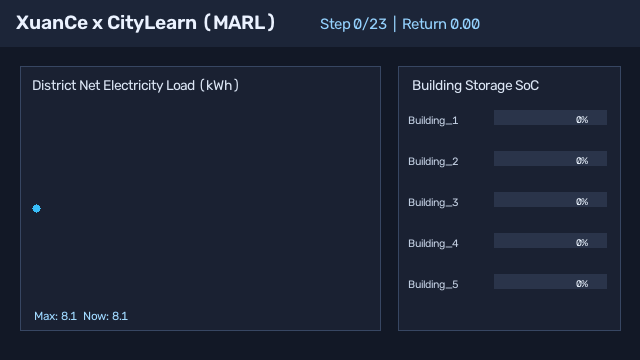
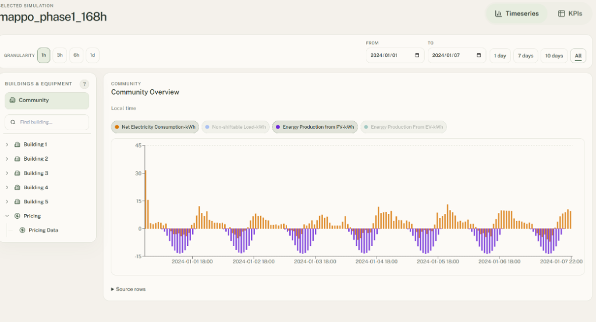

# XuanCe × CityLearn: Smart-Grid Building Energy Coordination (DRL & MARL)

[CityLearn](https://github.com/citylearn-project/CityLearn) is an open-source Gymnasium environment developed by the Intelligent Environments Laboratory / LF Energy for benchmarking demand response, distributed energy resource (DER) coordination, and urban microgrid control across multiple buildings.

XuanCe integrates CityLearn through **both** single-agent centralized control ([`CityLearn_Env`](../../xuance/environment/single_agent_env/citylearn.py), `central_agent=True`) and decentralized multi-agent coordination ([`CityLearn_MultiAgentEnv`](../../xuance/environment/multi_agent_env/citylearn.py), `central_agent=False`), supporting heterogeneous storage/PV/EV districts, automatic action rescaling, district KPI evaluation, and headless dashboard visualization.

<p align="center">
  
  <br/>
  <sub><i>Headless RGB rollout dashboard rendered via <code>citylearn_demo.py --save-gif</code> (MAPPO on <code>citylearn_challenge_2022_phase_1</code>)</i></sub>
</p>

---

## Why XuanCe × CityLearn?

- **Dual Control Paradigm (Centralized DRL & Decentralized MARL)**:
  - **Single-Agent DRL (`env_name: "CityLearn"`)**: Treats the district operator as a single centralized policy controlling all buildings jointly (`PPO`, `SAC`, `TD3`, `DDPG`).
  - **Multi-Agent MARL (`env_name: "citylearn"`)**: Assigns one autonomous agent per building (`Building_1`, `Building_2`, …) with cooperative/decentralized execution (`MAPPO`, `IPPO`, `MASAC`, `MATD3`, `MADDPG`).
- **Unified Symmetric `[-1, 1]` Action Interface**: CityLearn assets can expose asymmetric bounds (e.g., `[0, 1]` thermal/DHW storage vs `[-1, 1]` batteries). Both XuanCe wrappers expose normalized `Box(-1.0, 1.0)` spaces and linearly map actions back to each device's physical bounds inside `step()`.
- **Built-in Observation Normalization & Heterogeneous Padding**:
  - Wraps CityLearn with `NormalizedObservationWrapper` by default (`normalize_obs: True`) so cyclical temporal features (`hour`, `month`, `day_type`) use sine/cosine encoding and sensor bounds normalize to `[0, 1]`.
  - Provides `pad_spaces` in `CityLearn_MultiAgentEnv` so parameter-sharing MARL algorithms (`MAPPO`, `IPPO`, `MASAC`, `MATD3`) run seamlessly even across districts whose buildings have different sensor or actuator counts, while `MADDPG` (`use_parameter_sharing: False`) supports unpadded heterogeneous dimensions natively.
- **District KPI Extraction & Headless Dashboard Rendering**:
  - Set `evaluate_on_done: True` (or pass `--eval-kpis` to `citylearn_demo.py`) to compute official CityLearn district KPIs (`cost_total`, `carbon_emissions_total`, `electricity_consumption_total`, `daily_peak_average`, `ramping_average`, etc.) before vectorized environments auto-reset.
  - Built-in lightweight OpenCV RGB dashboard (`render("rgb_array")`) requires no X11/OpenGL display and works on headless Linux servers.

---

## Installation

Install XuanCe with the optional `citylearn` extra (or install `citylearn` inside an existing XuanCe environment):

```bash
pip install "xuance[citylearn]"
# or, in an existing XuanCe environment:
pip install citylearn
```

> [!NOTE]
> The first time a named CityLearn dataset (such as `citylearn_challenge_2022_phase_1`) is loaded, `citylearn` downloads the dataset files from GitHub into the local CityLearn user cache and reuses the cached files on subsequent runs. You can also pass a local `schema.json` path or schema `dict` for fully offline custom scenarios.

---

## Supported Algorithms & Built-in Configs

All nine built-in configurations set `env_id: null` so any CityLearn dataset name or `schema.json` path can be selected at runtime via `get_runner(..., env="citylearn", env_id=...)` or `citylearn_demo.py --dataset ...`.

### Multi-Agent RL (`env_name: "citylearn"`, `central_agent=False`)

| Algorithm (`--algo`) | Parameter Sharing | `pad_spaces` | Vectorizer | Config File |
| :--- | :---: | :---: | :--- | :--- |
| `mappo` | `True` | `True` | `DummyVecMultiAgentEnv` | [`xuance/configs/mappo/citylearn.yaml`](../../xuance/configs/mappo/citylearn.yaml) |
| `ippo` | `True` | `True` | `DummyVecMultiAgentEnv` | [`xuance/configs/ippo/citylearn.yaml`](../../xuance/configs/ippo/citylearn.yaml) |
| `masac` | `True` | `True` | `DummyVecMultiAgentEnv` | [`xuance/configs/masac/citylearn.yaml`](../../xuance/configs/masac/citylearn.yaml) |
| `matd3` | `True` | `True` | `DummyVecMultiAgentEnv` | [`xuance/configs/matd3/citylearn.yaml`](../../xuance/configs/matd3/citylearn.yaml) |
| `maddpg` | `False` | `False` | `DummyVecMultiAgentEnv` | [`xuance/configs/maddpg/citylearn.yaml`](../../xuance/configs/maddpg/citylearn.yaml) |

### Single-Agent RL (`env_name: "CityLearn"`, `central_agent=True`)

| Algorithm (`--algo`) | Action Output Activation | Vectorizer | Config File |
| :--- | :---: | :--- | :--- |
| `ppo` | `tanh` (`[-1, 1]`) | `DummyVecEnv` | [`xuance/configs/ppo/citylearn.yaml`](../../xuance/configs/ppo/citylearn.yaml) |
| `sac` | `tanh` (`[-1, 1]`) | `DummyVecEnv` | [`xuance/configs/sac/citylearn.yaml`](../../xuance/configs/sac/citylearn.yaml) |
| `td3` | `tanh` (`[-1, 1]`) | `DummyVecEnv` | [`xuance/configs/td3/citylearn.yaml`](../../xuance/configs/td3/citylearn.yaml) |
| `ddpg` | `tanh` (`[-1, 1]`) | `DummyVecEnv` | [`xuance/configs/ddpg/citylearn.yaml`](../../xuance/configs/ddpg/citylearn.yaml) |

---

## Representative Datasets (`--dataset` / `env_id`)

Any dataset listed by `citylearn.data.DataSet().get_dataset_names()` or a local `schema.json` file path works directly:

| Dataset (`env_id`) | Description | Buildings | Key Control Assets |
| :--- | :--- | :---: | :--- |
| `citylearn_challenge_2022_phase_1` | NeurIPS 2022 CityLearn Challenge Phase 1 (grid cost & carbon minimization) | 5 | Electrical batteries + PV |
| `citylearn_challenge_2022_phase_all` | Full 17-building residential community from CityLearn Challenge 2022 | 17 | Electrical batteries + PV |
| `citylearn_challenge_2023_phase_1` | CityLearn Challenge 2023 multi-resource demand response & thermal comfort | 6 | Batteries, heat pumps, DHW, cooling |
| `baeda_3dem` | 4-building neighborhood with LSTM thermal dynamics (requires `citylearn[dynamics]`) | 4 | Thermal storage + heat pump |
| `/path/to/schema.json` | Custom local CityLearn community schema | Custom | Custom DERs / EVs / pricing |

---

## Quick Start CLI (`citylearn_demo.py`)

Run from the repository root (`xuance/`):

```bash
# 1. Decentralized Multi-Agent MAPPO with KPI evaluation and GIF dashboard export
python examples/CityLearn/citylearn_demo.py \
  --algo mappo \
  --dataset citylearn_challenge_2022_phase_1 \
  --episode-time-steps 168 \
  --running-steps 16000 \
  --eval-kpis \
  --save-gif results/citylearn_mappo.gif

# 2. Off-policy Multi-Agent MASAC
python examples/CityLearn/citylearn_demo.py --algo masac --parallels 4 --running-steps 20000 --eval-kpis

# 3. Independent Multi-Agent MADDPG (no parameter sharing; heterogeneous building spaces)
python examples/CityLearn/citylearn_demo.py --algo maddpg --parameter-sharing false --pad-spaces false --eval-kpis

# 4. Centralized Single-Agent SAC controlling the entire community jointly
python examples/CityLearn/citylearn_demo.py --algo sac --dataset citylearn_challenge_2022_phase_1 --running-steps 16000 --eval-kpis

# 5. Centralized Single-Agent PPO
python examples/CityLearn/citylearn_demo.py --algo ppo --episode-time-steps 168 --running-steps 16000 --eval-kpis

# 6. Export full CSV telemetry & KPIs for interactive inspection in CityLearn UI
python examples/CityLearn/citylearn_demo.py \
  --algo mappo \
  --dataset citylearn_challenge_2022_phase_1 \
  --episode-time-steps 168 \
  --running-steps 16000 \
  --eval-kpis \
  --export-ui-dir results/citylearn_ui \
  --ui-session-name mappo_phase1
```

### Demo CLI Reference

| Flag | Default | Description |
| :--- | :--- | :--- |
| `--algo` | `mappo` | Algorithm: `mappo`, `ippo`, `masac`, `maddpg`, `matd3`, `ppo`, `sac`, `td3`, `ddpg` |
| `--dataset` | `citylearn_challenge_2022_phase_1` | CityLearn dataset name or local `schema.json` path |
| `--mode` | `benchmark` | Runner mode (`train`, `test`, `benchmark`) |
| `--device` | `cuda:0` (if available) else `cpu` | Neural network training device |
| `--parallels` | `4` | Number of parallel vectorized environments |
| `--buffer-size` | `None` | Optional rollout/replay buffer override |
| `--episode-time-steps` | `168` | Timestamps per episode (`24` = 1 day, `168` = 1 week, `8760` = 1 year) |
| `--running-steps` | `16000` | Total environment steps to train |
| `--eval-interval` | `4000` | Evaluation frequency during `benchmark` |
| `--test-episode` | `2` | Episodes per evaluation round |
| `--seed` | `1` | Random seed (`seed` and `env_seed`) |
| `--parameter-sharing` | `auto` | MARL override (`auto`, `true`, `false`) |
| `--pad-spaces` | `auto` | MARL space padding override (`auto`, `true`, `false`) |
| `--eval-kpis` | `False` | Run deterministic evaluation episode and print district KPIs |
| `--save-gif` | `None` | Output path for the RGB evaluation dashboard GIF |
| `--export-ui-dir` | `None` | Directory to export CityLearn UI CSV telemetry and KPI files |
| `--ui-session-name` | `None` | Optional session subfolder name inside `--export-ui-dir` (`<algo>_<dataset>` by default) |

---

## Python API & Configuration Options

### 1. Standard Training via `xuance.get_runner`

Note that `env="citylearn"` works uniformly for **both** MARL and DRL algorithms (each algorithm's `xuance/configs/<algo>/citylearn.yaml` selects `env_name: "citylearn"` or `env_name: "CityLearn"` automatically):

```python
from argparse import Namespace
from xuance import get_runner

# Multi-agent decentralized control (MAPPO)
marl_args = Namespace(
    device="cpu",
    parallels=4,
    episode_time_steps=168,
    running_steps=16000,
    eval_interval=4000,
    evaluate_on_done=True,
    render=False,
)
marl_runner = get_runner(
    algo="mappo",
    env="citylearn",
    env_id="citylearn_challenge_2022_phase_1",
    parser_args=marl_args,
)
marl_runner.run(mode="benchmark")

# Single-agent centralized control (SAC)
drl_args = Namespace(
    device="cpu",
    parallels=4,
    episode_time_steps=168,
    running_steps=16000,
    eval_interval=4000,
    render=False,
)
drl_runner = get_runner(
    algo="sac",
    env="citylearn",
    env_id="citylearn_challenge_2022_phase_1",
    parser_args=drl_args,
)
drl_runner.run(mode="benchmark")
```

### 2. Custom Schema Dictionary via `make_envs`

When passing an in-memory CityLearn `schema` dictionary (or overriding `citylearn_kwargs`), configure `config.schema` and build environments directly with `make_envs`:

```python
from argparse import Namespace
from xuance.common import get_arguments
from xuance.environment import make_envs
from xuance.torch.agents import MASAC_Agents

config = get_arguments(
    algo="masac",
    env="citylearn",
    env_id="custom_district",
    parser_args=Namespace(
        parallels=2,
        episode_time_steps=48,
        citylearn_kwargs={"reward_function": "citylearn.reward_function.SolarPenaltyReward"},
        evaluate_on_done=True,
    ),
)
# config.schema = my_schema_dict  # Optional dict or path to custom schema.json
config.schema = "citylearn_challenge_2022_phase_1"
envs = make_envs(config)
agents = MASAC_Agents(config=config, envs=envs)
agents.train(1000)
agents.finish()
envs.close()
```

### 3. Exporting Evaluation Sessions to CityLearn UI

[CityLearn UI](https://github.com/Soft-CPS-Research-Group/citylearn-ui) ([hosted web app](https://citylearnui.netlify.app/)) is a client-side browser dashboard for inspecting community net load, per-building PV/battery/HVAC schedules, pricing/carbon curves, and BAU baseline comparisons directly from CityLearn's exported telemetry folders.

<p align="center">
  
  <br/>
  <sub><i>CityLearn UI Community Overview loaded from an exported XuanCe MAPPO 168-hour rollout (<code>mappo_phase1_168h</code>)</i></sub>
</p>

Keep `citylearn_render_mode="none"` during training for maximum throughput, and enable `citylearn_render_mode="end"` with `render_directory` and `render_session_name` inside `citylearn_kwargs` during final evaluation (or pass `--export-ui-dir` to `citylearn_demo.py`):

```python
from argparse import Namespace
from pathlib import Path
from xuance.common import get_arguments
from xuance.environment import make_envs

export_root = str(Path("outputs/citylearn_ui").resolve())
eval_config = get_arguments(
    algo="mappo",
    env="citylearn",
    env_id="citylearn_challenge_2022_phase_1",
    parser_args=Namespace(
        parallels=1,
        episode_time_steps=168,
        citylearn_render_mode="end",
        citylearn_kwargs={
            "render_directory": export_root,
            "render_session_name": "mappo_eval",
        },
        evaluate_on_done=True,
    ),
)
eval_envs = make_envs(eval_config)
# After stepping one full episode, import `outputs/citylearn_ui/mappo_eval` into CityLearn UI.
```

### 4. Key Configuration Parameters

| Key | Default | Notes |
| :--- | :--- | :--- |
| `env_name` | `"CityLearn"` (DRL) / `"citylearn"` (MARL) | Selects `CityLearn_Env` (`central_agent=True`) or `CityLearn_MultiAgentEnv` (`central_agent=False`) |
| `episode_time_steps` | `168` | Timestamps per episode; CityLearn executes `episode_time_steps - 1` transitions before `terminated=True` |
| `normalize_obs` | `True` | Applies `citylearn.wrappers.NormalizedObservationWrapper` (`[0, 1]` scaling + periodic time encoding) |
| `pad_spaces` | Follows `use_parameter_sharing` (MARL) | Zero-pads per-building observation/action vectors so parameter sharing supports heterogeneous buildings |
| `citylearn_kwargs` | `{}` | Dictionary forwarded directly to `CityLearnEnv(schema, **citylearn_kwargs)` |
| `evaluate_on_done` | `False` | When `True`, attaches `info["kpis"]` (district KPIs from `evaluate()`) on episode completion before auto-reset |
| `citylearn_render_mode` | `"none"` | Controls CityLearn's CSV exporter (`"none"`, `"during"`, `"end"`), kept separate from XuanCe's `render_mode="rgb_array"` |

---

## Troubleshooting & Notes

- **Episode Horizon (`episode_time_steps` vs `max_episode_steps`)**: In CityLearn, an episode configured with `episode_time_steps=T` starts at `t=0` and performs `T - 1` `step()` transitions until `t = T - 1` (`terminated=True`). The XuanCe wrappers automatically align `max_episode_steps = T - 1` (or `min(T - 1, config.max_episode_steps)` if a smaller limit is specified).
- **Subprocess Parallelism (`SubprocVecEnv` / `SubprocVecMultiAgentEnv`)**: Works for both single-agent and multi-agent CityLearn environments. If launching many workers on a dataset that is not yet cached, load the dataset once first (or run a 1-step warmup) so multiple processes do not download the same cache simultaneously.
- **Verification**: Zero-dependency contract tests and real CityLearn integration tests live in [`tests/torch/test_citylearn.py`](../../tests/torch/test_citylearn.py).

---

## References

- **CityLearn**: Vázquez-Canteli, J. R., Kämpf, J., Henze, G., & Nagy, Z. *CityLearn v1.0: An OpenAI Gym Environment for Demand Response with Deep Reinforcement Learning*. BuildSys 2019. ([GitHub](https://github.com/citylearn-project/CityLearn))
- **XuanCe**: Liu, W., et al. *XuanCe: A Comprehensive and Unified Deep Reinforcement Learning Library*. arXiv:2312.16248, 2023. ([GitHub](https://github.com/agi-brain/xuance))
